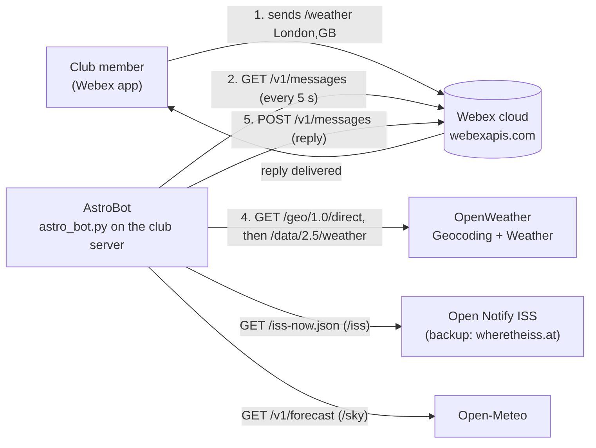

# 🚀 Space Bot API Investigation Sheet

**Total Marks: 40**  
**TASK 1: Collect Required API Documentation**

This investigation sheet helps you gather key technical information from the three APIs required for the Space Bot project: **Webex Messaging API**, **ISS Current Location API**, **Weather API** and a **Geocoding API** , plus the Python time module. Also furhter investigate the application of Web Architecture and MVC design pattern in development of the Bot

---

##  Webex Messaging API (4 marks)

| Criteria | Details |
|---------|---------|
| API Base URL | `https://webexapis.com/v1` |
| Authentication Method | OAuth 2.0 **Bearer token** in the `Authorization` header. AstroBot uses a *personal access token* from developer.webex.com, which acts as your own account and expires 12 hours after you sign in to the Developer Portal. Bot and integration tokens are sent the same way. |
| Endpoint to list rooms | `GET /rooms` (`https://webexapis.com/v1/rooms`). Optional query parameters: `type` (`direct` or `group`), `sortBy` (`id`, `lastactivity` or `created`) and `max` (1–1000, default 100). |
| Endpoint to get messages | `GET /messages?roomId={roomId}&max={n}`. `roomId` is **required**, and `max` defaults to 50. Messages come back newest first, so `max=1` returns only the latest one. |
| Endpoint to send message | `POST /messages` with a JSON body such as `{"roomId": "...", "text": "..."}`. A `markdown` field can be used for rich text, with `text` as the plain-text fallback. The maximum message length is 7439 bytes. |
| Required headers | `Authorization: Bearer <access token>` on every request, plus `Content-Type: application/json` on the `POST`. (`Accept: application/json` is optional.) |
| Sample full GET or POST request | `curl -X POST "https://webexapis.com/v1/messages" -H "Authorization: Bearer $WEBEX_ACCESS_TOKEN" -H "Content-Type: application/json" -d '{"roomId": "Y2lzY29zcGFyazovL3VzL1JPT00v...", "text": "Hello from AstroBot"}'` |

**Example response for `GET /messages?roomId=...&max=1`** (the documented format, trimmed to the fields AstroBot reads; the `text` has been changed to an AstroBot command):

```json
{
  "items": [
    {
      "id": "Y2lzY29zcGFyazovL3VzL01FU1NBR0UvOTJkYjNiZTAtNDNiZC0xMWU2LThhZTktZGQ1YjNkZmM1NjVk",
      "roomId": "Y2lzY29zcGFyazovL3VzL1JPT00vYmJjZWIxYWQtNDNmMS0zYjU4LTkxNDctZjE0YmIwYzRkMTU0",
      "roomType": "group",
      "text": "/weather London",
      "personId": "Y2lzY29zcGFyazovL3VzL1BFT1BMRS9mNWIzNjE4Ny1jOGRkLTQ3MjctOGIyZi1mOWM0NDdmMjkwNDY",
      "personEmail": "matt@example.com",
      "created": "2015-10-18T14:26:16+00:00"
    }
  ]
}
```

**Other findings that affect the bot**

- **Rate limiting:** Webex answers `429 Too Many Requests` with a `Retry-After` header that says how long to wait. Most endpoints allow about 300 requests a minute; `/messages` has a higher, dynamically adjusted quota. AstroBot polls once every 5 seconds (12 requests a minute).
- **Bot accounts:** in group spaces, a bot account can only read messages that @mention it. This is why AstroBot uses a personal access token, which can read every message in the selected room.
- **Personal tokens:** any message AstroBot sends appears as coming from you, so the bot has to recognise and skip its own replies when it reads the latest message.

---

##  ISS Current Location API (2 marks)

| Criteria | Details |
|---------|---------|
| API Base URL | `http://api.open-notify.org`. HTTP only: HTTPS connections to this host are refused. |
| Endpoint for current ISS location | `GET /iss-now.json` (`http://api.open-notify.org/iss-now.json`). No authentication and no parameters. |
| Sample response format (example JSON) | Live response captured on 23 Oct 2026 (below) |

```json
{
  "timestamp": 1792780126,
  "message": "success",
  "iss_position": {
    "latitude": "10.0567",
    "longitude": "80.7557"
  }
}
```

**Findings**

- `timestamp` is a Unix epoch time in seconds (UTC) for when the position was valid. `1792780126` converts to **2026-10-23 18:28:46 UTC** (see the epoch section below).
- `latitude` and `longitude` are returned as **strings**, so AstroBot converts them with `float()` before reverse geocoding and formatting them.
- `message` is `"success"` when the request worked.
- Poll rate: the docs ask each client to poll at most about once every 5 seconds, since the position is only recalculated once a second. AstroBot calls this API only when someone sends `/iss`.
- Because the API is plain HTTP, its responses could be read or altered in transit. No credentials are ever sent to it, so the only risk is to the data's integrity.
- **Reliability:** Open Notify is a volunteer-run service. On 23 Oct 2026, one in four direct `curl` calls hung for the full 12-second timeout, another took 3.3 seconds, and one bot test failed with `ConnectTimeout`. AstroBot therefore waits at most 5 seconds for it and then switches to a backup provider.

**Backup ISS provider: "Where the ISS at?"**

| Criteria | Details |
|---------|---------|
| API Base URL | `https://api.wheretheiss.at/v1` (HTTPS) |
| Endpoint | `GET /satellites/25544` (25544 is the ISS's NORAD catalogue ID). Optional parameters: `units` (`kilometers` or `miles`) and `timestamp`. |
| Authentication | None. The docs ask clients to stay at roughly one request per second. |
| Used for | Automatic fallback in `get_iss_backup_position()`, which reshapes the reply into Open Notify's format. Unlike Open Notify, `latitude` and `longitude` are numbers. |

```json
{
  "name": "iss",
  "id": 25544,
  "latitude": -3.5136102100201,
  "longitude": -110.36503394941,
  "altitude": 422.80524224197,
  "velocity": 27567.288735574,
  "visibility": "daylight",
  "timestamp": 1792781908,
  "units": "kilometers"
}
```
*(Live response captured on 23 Oct 2026, trimmed: the `footprint`, `daynum` and `solar_lat`/`solar_lon` fields are omitted.)*

---

##  Geocoding API (4 marks)

| Criteria | Details |
|---------|---------|
| Provider used (Choose one) | **OpenWeatherMap Geocoding API.** It uses the same account and API key as the Weather API, so the bot needs only one weather key. |
| API Base URL | `https://api.openweathermap.org/geo/1.0`. The docs show `http://`, but HTTPS works and keeps the API key encrypted in transit. |
| Endpoint for geocoding | `GET /direct?q={city name},{state code},{country code}&limit={limit}&appid={API key}` (place name to coordinates) |
| Endpoint for reverse geocoding | `GET /reverse?lat={lat}&lon={lon}&limit={limit}&appid={API key}` (coordinates to place name) |
| Authentication method | API key passed as the `appid` query parameter |
| Required query parameters | Direct: `q` and `appid`; `limit` is optional, up to 5 results. Reverse: `lat`, `lon` and `appid`; `limit` is optional. Country codes in `q` use ISO 3166, e.g. `q=Paris,FR`. |
| Sample request with latitude/longitude | `https://api.openweathermap.org/geo/1.0/reverse?lat=51.5098&lon=-0.1180&limit=1&appid={API key}` |
| Sample JSON response (formatted example) | First result of the documented reverse-geocoding example (below; the `local_names` translations are omitted) |

```json
[
  {
    "name": "City of London",
    "lat": 51.5128,
    "lon": -0.0918,
    "country": "GB"
  }
]
```

**Findings**

- Both endpoints return a JSON **array**, best match first. AstroBot asks for `limit=1` and uses `data[0]`.
- A direct lookup for `London` with `limit=5` returns London (GB), City of London, London (Ontario, CA), Chelsea and London (Kentucky, US). Adding a country code (`London,GB`) makes the result unambiguous.
- `state` is only present for some locations, so the bot reads it with `.get()` and handles it being missing.
- **Reverse geocoding over the ocean returns an empty array `[]`.** The ISS is over water most of the time, so AstroBot then shows *"Over Ocean / No Nearby City"*.

---


##  Weather API (3 marks)

| Criteria | Details |
|---------|---------|
| API Provider (Choose one) | **OpenWeather Current Weather Data API.** The free plan allows 60 calls a minute and 1,000,000 calls a month, and includes the Geocoding API. |
| API Base URL | `https://api.openweathermap.org/data/2.5` |
| Endpoint for current weather | `GET /weather?lat={lat}&lon={lon}&appid={API key}&units=metric` |
| Authentication method | API key passed as the `appid` query parameter. A new key activates automatically up to 2 hours after registration; until then every call returns `401 Invalid API key`. |
| Required query parameters | `lat`, `lon` and `appid`. Optional: `units` (`standard` is the default and gives Kelvin; `metric` gives °C and m/s), `lang` and `mode`. Looking a city up by name (`q=`) is deprecated, so AstroBot gets coordinates from the Geocoding API first. |
| Sample JSON response (formatted example) | The documented example (below). It uses the default `standard` units, so `temp` is in Kelvin. |

```json
{
  "coord": { "lon": 10.99, "lat": 44.34 },
  "weather": [
    { "id": 501, "main": "Rain", "description": "moderate rain", "icon": "10d" }
  ],
  "base": "stations",
  "main": {
    "temp": 298.48,
    "feels_like": 298.74,
    "temp_min": 297.56,
    "temp_max": 300.05,
    "pressure": 1015,
    "humidity": 64,
    "sea_level": 1015,
    "grnd_level": 933
  },
  "visibility": 10000,
  "wind": { "speed": 0.62, "deg": 349, "gust": 1.18 },
  "rain": { "1h": 3.16 },
  "clouds": { "all": 100 },
  "dt": 1661870592,
  "sys": {
    "type": 2,
    "id": 2075663,
    "country": "IT",
    "sunrise": 1661834187,
    "sunset": 1661882248
  },
  "timezone": 7200,
  "id": 3163858,
  "name": "Zocca",
  "cod": 200
}
```

**Fields AstroBot uses**

| Field | Meaning | Used for |
|-------|---------|----------|
| `weather[0].id`, `weather[0].description` | Condition code (2xx thunderstorm, 3xx drizzle, 5xx rain, 6xx snow, 7xx fog/haze, 800 clear, 80x clouds) and its text | Conditions line; rain, snow and fog rule out stargazing |
| `main.temp`, `main.feels_like`, `main.humidity` | Temperature (°C with `units=metric`) and relative humidity (%) | Temperature and humidity lines |
| `clouds.all` | Cloud cover (%) | Main input to the stargazing verdict |
| `visibility` | Visibility in metres, capped at 10,000 | Haze check in the stargazing verdict |
| `wind.speed` | Wind speed (m/s with `metric`) | Wind line (strong wind shakes telescopes) |
| `dt`, `timezone`, `sys.sunrise`, `sys.sunset` | UTC epoch times and the location's offset from UTC in seconds | Local observation time, sunrise and sunset, and whether it is currently dark |
| `name`, `sys.country` | Place name and two-letter country code. Over the ocean `name` is an empty string and `country` is missing. | Location line, with an "Unknown" fallback |

---

##  Epoch to Human Time Conversion (Python time module) (2 marks)

| Criteria | Details |
|---------|---------|
| Library used | `time` (Python standard library). `datetime` is also used, to show weather times in each city's local time. |
| Function used to convert epoch | `time.gmtime()` converts epoch seconds to a UTC `struct_time`, and `time.strftime()` formats it as text. Both are wrapped in `epoch_to_utc()` in `astro_bot.py`. |
| Sample code to convert timestamp | See the code below |
| Output (human-readable time) | `2026-10-23 18:28:46 UTC` |

```python
import time

timestamp = 1792780126                      # "timestamp" field from the ISS API response
utc_time = time.gmtime(timestamp)           # struct_time in UTC
print(time.strftime("%Y-%m-%d %H:%M:%S UTC", utc_time))   # -> 2026-10-23 18:28:46 UTC
```

**Findings**

- The Python docs define the epoch as *"January 1, 1970, 00:00:00 (UTC) on all platforms"*. API timestamps are seconds since that moment.
- `time.gmtime()` was chosen over `time.localtime()` and `time.ctime()` because those two use the **server's** time zone. On this PC (UK, BST) `time.ctime(1792780126)` gives `Fri Oct 23 19:28:46 2026`, an hour ahead of UTC. The ISS is never in the server's time zone, so its time is shown in UTC.
- For `/weather`, OpenWeather supplies `dt`, `sys.sunrise` and `sys.sunset` (UTC epoch) plus `timezone` (the offset in seconds). `format_local_time()` uses `datetime.fromtimestamp(ts, tz=timezone(timedelta(seconds=offset)))` to show them in the **city's own local time**. For example, Sydney showed `Sat 24 Oct 2026, 05:59` when UTC was 18:59 on 23 Oct.

---

##  Extended Feature API ( 3 marks)

| Criteria | Details |
|---------|---------|
| API Provider | **Open-Meteo Forecast API**: free, open-source weather and astronomy data, used for the new `/sky <city>` command |
| API Base URL | `https://api.open-meteo.com/v1` |
| Endpoint | `GET /forecast` |
| Authentication method | None for non-commercial use. An `apikey` is only needed for the commercial `customer-` API. |
| Required query parameters | `latitude` and `longitude`. AstroBot also sends `hourly=cloud_cover,visibility,precipitation_probability,is_day`, `daily=sunrise,sunset,moonrise,moonset,moon_phase`, `timezone=auto` (times in the city's local time; required when asking for daily values), `past_days=1` and `forecast_days=2`. |
| Sample JSON response (formatted example) | Live response for London captured on 23 Oct 2026 (below), trimmed to three evening hours and one day |

```json
{
  "latitude": 51.51147,
  "longitude": -0.13078308,
  "utc_offset_seconds": 3600,
  "timezone": "Europe/London",
  "timezone_abbreviation": "GMT+1",
  "elevation": 16.0,
  "hourly_units": { "time": "iso8601", "cloud_cover": "%", "visibility": "m", "precipitation_probability": "%", "is_day": "" },
  "hourly": {
    "time": ["2026-10-23T20:00", "2026-10-23T21:00", "2026-10-23T22:00"],
    "cloud_cover": [78, 91, 66],
    "visibility": [26840.0, 28260.0, 32020.0],
    "precipitation_probability": [39, 20, 6],
    "is_day": [0, 0, 0]
  },
  "daily_units": { "time": "iso8601", "sunrise": "iso8601", "sunset": "iso8601", "moonrise": "iso8601", "moonset": "iso8601", "moon_phase": "fraction" },
  "daily": {
    "time": ["2026-10-23"],
    "sunrise": ["2026-10-23T07:38"],
    "sunset": ["2026-10-23T17:50"],
    "moonrise": ["2026-10-23T16:33"],
    "moonset": ["2026-10-23T04:06"],
    "moon_phase": [0.403]
  }
}
```

**Why Open-Meteo?** It was one of the suggested APIs and is the one most useful for *planning* observation nights:

- It forecasts **hourly cloud cover**, which matters most for stargazing. OpenWeather's free current-weather call only describes the present moment.
- It provides **moonrise, moonset and moon phase**. A bright Moon washes out faint galaxies and nebulae, so these decide what is worth observing.
- It needs **no API key**, so there is no extra secret to manage and nothing to sign up for. It is reached over HTTPS.
- `/sky` reuses the OpenWeather geocoding call (`get_city_coordinates()`) to turn a city name into coordinates, so the extension fits into the existing structure.

**Findings from testing the data**

- Hourly `time` values are **local clock times without an offset** (with `timezone=auto`), so the bot compares them with the city's local "now", computed from `utc_offset_seconds`.
- `moon_phase` is not documented on the docs page. Fetching a month of values showed it climbs steadily from 0 to 1 through the lunar cycle: it wrapped from 0.993 to 0.026 at the 10 Oct 2026 new moon and passed 0.5 at the 26 Oct full moon. So **0 = new, 0.25 = first quarter, 0.5 = full, 0.75 = last quarter**, and the illuminated fraction is (1 − cos 2π·phase) / 2. For 0.403 that gives about 91%.
- `moonrise`/`moonset` can be `null` on days when the Moon does not rise or set, so the bot skips missing values.
- `is_day` (1 or 0) marks the dark hours. In places with the midnight sun no hour is dark, and the bot says so instead of reporting an empty forecast.

**How `/sky` turns the data into advice** (`ASTRONOMY EXTENSION FUNCTIONS` in `astro_bot.py`)

1. `get_night_hours()` takes the dark hours from now until the next sunrise. If fewer than 3 are left (a request at dawn), it moves on to the next night.
2. `find_best_window()` finds the longest run of hours with cloud cover of 30% or less and a rain chance under 50%.
3. `describe_moon()` names the phase and works out how much of the Moon is lit. `describe_moon_visibility()` reports moonrise and moonset during the dark hours.
4. `assess_sky()` gives a Good, Fair or Poor verdict from the average cloud cover. It then adds moonlight advice (dark skies for galaxies, or a bright Moon that suits the Moon and planets) and a warning if the forecast visibility drops below 2 km (mist or fog).

Example reply (live, 23 Oct 2026):

```text
🔭 Stargazing forecast for London, England, GB, night of Fri 23 Oct
🌇 Sunset 17:50 · 🌅 Sunrise 07:39 (local time)
☁️ Cloud after dark: 48% on average (lowest 0% at 02:00)
✨ Best viewing window: 00:00-04:00 (cloud 30% or less)
🌧️ Highest chance of rain: 39%
🌔 Moon: Waxing Gibbous, 91% lit, sets 05:26
🔭 Verdict: ⚠️ Fair - partly cloudy with clear spells; the bright Moon favours the Moon and planets over faint galaxies
```

--- 

##  Evaluation – Web Architecture, MVC Design & Security 

In this section, evaluate how web technologies, architecture, and design patterns have been applied in your **AstroBot**. Your responses must relate directly to your implementation and include reflection on your design decisions.

---

###  Web Architecture – Client–Server Model (3 marks)

Explain how the client–server model applies to your AstroBot:

- Identify the **client** 
- Identify the **server(s)** 
- Describe how data flows between:
  - User, AstroBot and APIs

Include a **simple block diagram** to illustrate this interaction.

**Clients**

- **AstroBot itself (`astro_bot.py`) is an HTTP client.** It never listens on a port. Every exchange is a request that AstroBot starts, and a server answers it.
- Club members' **Webex apps** (phone or desktop) are also clients of the same Webex cloud. Members never talk to AstroBot directly: both sides meet in the shared room.

**Servers**

| Server | Role | Called from |
|--------|------|-------------|
| Webex cloud (`webexapis.com`) | Stores rooms and messages; delivers replies to members | `get_rooms()`, `get_latest_message()`, `send_message()` |
| OpenWeather (`api.openweathermap.org`) | Geocoding (city to coordinates and back) and current weather | `get_city_coordinates()`, `reverse_geocode()`, `get_current_weather()` |
| Open Notify (`api.open-notify.org`), with `api.wheretheiss.at` as backup | Live ISS position | `get_iss_location()`, `get_iss_backup_position()` |
| Open-Meteo (`api.open-meteo.com`) | Hourly cloud forecast, sun and Moon times for `/sky` | `get_sky_forecast()` |

**Data flow for one command, e.g. `/weather London,GB`**

1. A member types the command. Their Webex app sends it to the Webex cloud, which stores it in the room.
2. AstroBot's polling loop in `main()` sends `GET /v1/messages?roomId=…&max=1` every 5 seconds and receives the newest message as JSON.
3. The controller sees a new message ID that starts with `/` and splits it into the command `/weather` and the argument `London,GB`. It validates the argument, then calls `get_weather()`.
4. `get_weather()` calls the OpenWeather Geocoding API (JSON array of matches, giving latitude and longitude), then the Current Weather API (JSON object).
5. `format_weather_report()` builds the reply text, and `send_message()` sends it with `POST /v1/messages`. The Webex cloud stores it and pushes it to every member's app.



*Every arrow from AstroBot is a request that AstroBot starts. Each server sends back a JSON response along the same connection. Every connection uses HTTPS except Open Notify, which only offers HTTP.*

**Design decision: polling instead of webhooks.** Webex could instead push each new message to AstroBot (a webhook). That would make AstroBot a *server*, needing a public HTTPS address and a hole in the club's firewall. Polling keeps AstroBot a pure client that can run behind the club's Wi-Fi with no inbound connections. The cost is a reply delay of up to 5 seconds and 12 requests a minute, well inside Webex's limit of roughly 300 requests a minute.

####  Security Considerations: (3 marks )
- Consider but not limiting to secure handling of API keys and tokens, API rate limiting, and Input validation (e.g., handling user commands safely), include examples from code where necessary to illustrate.

**1. API keys and tokens**

- **Nothing secret is in the source code or Git history.** `.gitignore` was the very first commit made in this project (`efbe946`), before any key existed, and it excludes `.env`. The committed `.env.example` documents the variable names with empty values.
- **Keys are loaded at run time.** `main()` calls `load_dotenv()`, and `get_api_key()` offers the saved value. If the user types a key instead, `getpass` hides it, so it never appears on screen or in terminal recordings for the video:

  ```python
  key = getpass(f"Enter your {prompt}: ").strip()
  ```

- **Keys are never written to logs.** Exception messages from `requests` include the full URL, and the OpenWeather URL contains `appid=<key>`. Every handler therefore prints only the exception's type:

  ```python
  except requests.RequestException as error:
      print("API request failed:", type(error).__name__)
  ```

  The unit test `test_network_errors_do_not_stop_the_bot_or_leak_the_key` passes a fake key inside an error message and checks it never reaches the console. A deliberately broken version of the bot that printed the full error failed this test. During the live Webex test, neither the token nor the key appeared in the bot's log.
- **Traffic is encrypted.** Webex, OpenWeather (although its docs show `http://`), Open-Meteo and the backup ISS API are all called over HTTPS. Open Notify only offers HTTP, but no credential is ever sent to it.
- **The token has limits.** A personal access token acts as the user and expires after 12 hours. When it expires, `get_latest_message()` stops the bot with a clear message instead of failing silently. A dedicated bot account would follow the principle of least privilege better, but in group spaces bots can only read messages that @mention them (see the Webex findings above).

**2. Rate limiting and timeouts**

- Polling every `POLL_INTERVAL = 5` seconds gives 12 requests a minute to Webex. On HTTP 429 the bot waits for the period in the `Retry-After` header before polling again.
- The ISS, weather and forecast APIs are called **only when a member asks**. Each command makes at most four calls, far below OpenWeather's free limit of 60 a minute, and Open Notify's "one request every 5 seconds" guidance is respected.
- Every request has a timeout (`REQUEST_TIMEOUT = 10` seconds, and `ISS_TIMEOUT = 5` for Open Notify), so a slow server cannot freeze the bot. A failed call is not retried in a loop. The only extra request is a single call to the backup ISS API.

**3. Input validation and safe command handling**

- Only messages starting with `/` are treated as commands, and the command word must match exactly (`/weatherParis` is rejected as unknown).
- City names go through `validate_city()`: at most 85 characters of letters, spaces, commas, full stops, apostrophes and hyphens (`CITY_PATTERN`). In the live test, `/weather <script>alert(1)</script>` was rejected with a polite message. The city is passed to `requests` as a `params=` value, which is URL-encoded, so it cannot change the request URL.
- The bot remembers the ID of every reply it posts and never processes its own messages, so it cannot get stuck answering itself. This was a real bug in the starter design, found in testing; see the commit `fix(webex): stop the bot from answering its own replies`.
- **Remaining risk:** any member of the room can send `/quit`. Limiting it to the person running the bot is listed as a future improvement.

---

###  RESTful API Usage in Your Application (3 marks )

Explain how REST APIs are used in your AstroBot: 

- Describe how HTTP methods (GET, POST) are used  
- Explain how your bot interacts with APIs (Webex, Weather, ISS, Geocoding)  
- Describe how JSON responses are received and processed  

Note: Relate your explanation directly to your code for higher grade. 

AstroBot uses REST APIs throughout. Each piece of data is a **resource** with its own URL (`/rooms`, `/messages`, `/weather`, `/iss-now.json`, `/forecast`), and the **HTTP method** says what to do with it. The requests are **stateless**: every request carries its own credentials (the `Authorization: Bearer …` header for Webex, the `appid` parameter for OpenWeather), so no server keeps a session for the bot.

| Function in `astro_bot.py` | Method and endpoint | Main parameters and body | Response used |
|---|---|---|---|
| `get_rooms()` | `GET webexapis.com/v1/rooms` | `sortBy=lastactivity`, `max=100` | `items[]` with `title`, `type` and `id` |
| `get_latest_message()` | `GET webexapis.com/v1/messages` | `roomId`, `max=1` | `items[0].id`, `items[0].text` |
| `send_message()` | **`POST`** `webexapis.com/v1/messages` | JSON body `{"roomId", "text", "markdown"}` | `id` of the new message, used to skip the bot's own replies |
| `get_city_coordinates()` | `GET …/geo/1.0/direct` | `q`, `limit=1`, `appid` | `[0].lat`, `[0].lon`, `name`, `state`, `country` |
| `reverse_geocode()` | `GET …/geo/1.0/reverse` | `lat`, `lon`, `limit=1`, `appid` | `[0]`, or `[]` over the ocean |
| `get_current_weather()` | `GET …/data/2.5/weather` | `lat`, `lon`, `units=metric`, `appid` | `weather[0]`, `main`, `clouds`, `wind`, `visibility`, `dt`, `timezone` and `sys` |
| `get_iss_location()` / `get_iss_backup_position()` | `GET api.open-notify.org/iss-now.json` / `GET api.wheretheiss.at/v1/satellites/25544` | none | `iss_position.latitude/longitude`, `timestamp` |
| `get_sky_forecast()` | `GET api.open-meteo.com/v1/forecast` | `latitude`, `longitude`, `hourly`, `daily`, `timezone=auto` | `hourly.*[]`, `daily.*[]`, `utc_offset_seconds` |

**GET and POST.** `GET` is used for everything AstroBot *reads*. These requests are safe (they change nothing on the server), so the bot can repeat them every 5 seconds. `POST` is used only to *create* a new message in the room. It sends a JSON body, which is why `send_message()` adds the `Content-Type: application/json` header and calls `json.dumps()`:

```python
headers = {"Authorization": token, "Content-Type": "application/json"}
data = {"roomId": room_id, "text": ..., "markdown": ...}
response = requests.post(url, headers=headers, data=json.dumps(data), timeout=REQUEST_TIMEOUT)
```

**How JSON is received and processed.** `response.json()` turns the body into Python dictionaries and lists. The bot then:

- picks out what it needs, e.g. `response.json().get("items", [])` for Webex, or `data[0] if data else None` for geocoding results, which arrive as arrays;
- converts types where needed: Open Notify returns `"latitude": "10.0567"` as a **string**, so it is converted with `float()`, while the backup API already returns numbers;
- converts epoch timestamps to readable times (`epoch_to_utc()` for the ISS, `format_local_time()` for city times) and the Moon's `moon_phase` fraction to a name and percentage lit (`describe_moon()`);
- passes the result to the formatting functions. These build the reply text, and `send_message()` encodes it back into JSON for the `POST`.

#### Security Considerations: (2 marks)
- Check response status codes, Handling invalid or unexpected API responses, Avoiding excessive API calls

- **Status codes are always checked before data is used.** Every function compares `response.status_code` with `200` first. Specific codes get specific handling:
  - Webex `429`: wait for the `Retry-After` period;
  - Webex `401`: the token has expired, so stop with instructions;
  - OpenWeather `401`: logged as e.g. `Geocoding API error: 401` (OpenWeather really did return 401 during development, while the new key was still activating);
  - any other non-200: a friendly reply such as *"⚠️ Sorry, the weather data could not be retrieved right now"*, never a crash.
- **Invalid or unexpected responses are handled safely.**
  - Fields are read with `.get()` and defaults, and `format_value()` / `format_place()` show **N/A** or **Unknown** for anything missing.
  - Malformed ISS coordinates are caught (`KeyError`, `TypeError`, `ValueError`).
  - As a last line of defence, the controller catches network errors and unexpected data around each command, so the bot always replies and keeps running.
  - If Open Notify times out (it did, several times in testing), `/iss` automatically uses the backup provider.
- **Excessive API calls are avoided.**
  - One `GET` every 5 seconds, using `max=1` so only one message is downloaded.
  - External APIs are called only when a command needs them, and never in retry loops.
  - Timeouts on every request.
  - Commands with invalid input are rejected *before* any API call is made.

---

###  MVC Design Pattern in AstroBot (3 Marks)

Explain how the **Model–View–Controller (MVC)** pattern applies to your solution:
Provide a short example based on your implementation

| Component   | Description and Example (Relate to your Bot) |
|------------|----------------------------------|
| **Model**  | **Data and rules, with no knowledge of chat formatting.** The API functions fetch and return raw data: `get_city_coordinates()`, `get_current_weather()`, `reverse_geocode()`, `get_iss_backup_position()`, `get_latest_message()`, and the Open-Meteo call in `get_sky_forecast()`. The domain rules turn data into decisions: `assess_stargazing()`, `is_daytime()`, `get_night_hours()`, `find_best_window()`, `describe_moon()` and `assess_sky()`. *Example:* `get_current_weather(51.5, -0.13, key)` returns the OpenWeather dictionary, and `assess_stargazing()` turns it into `"Poor - 87% cloud cover"`. |
| **View**   | **Presentation only.** The FORMATTING FUNCTIONS section turns model data into readable chat replies: `format_weather_report()`, `format_iss_report()`, `format_sky_report()`, `format_help()`, plus helpers such as `format_value()` (N/A for missing data), `format_coordinates()` and `format_local_time()`. `send_message()` hands the reply to Webex as markdown with a plain-text fallback, and the Webex app does the final rendering on members' screens. *Example:* `format_iss_report()` turns `lat=-46.8871, lon=-60.0843` into `📍 Coordinates: 46.8871° S, 60.0843° W` and adds a map link. |
| **Controller** | **Decides what happens.** `main()` loads the configuration, lets the operator pick a room, polls Webex, ignores old, duplicate and non-command messages, parses the command word and argument, validates input (`validate_city()`), and calls the right model and view functions. It also handles errors and remembers the bot's own reply IDs. *Example:* for `/sky Edinburgh`, `main()` validates `Edinburgh`, calls `get_sky_forecast()` and posts the result with `send_message()`. |

**Reflection on the design.** Separating the layers had practical benefits:

- The formatting could be redesigned in step 9 (markdown, emoji, local times) without touching any API code.
- The data rules can be unit-tested with fixed input, e.g. `test_stargazing_rules` and `SkyExtensionTests`, without a network.
- The `/sky` extension slotted into all three layers: it reuses the model's geocoding function, adds its own view function, and needs only one new branch in the controller.

Because the brief requires a single starter script, MVC is applied as **separate groups of functions** rather than separate classes or files. There is one compromise: `get_weather()`, `get_iss_location()` and `get_sky_forecast()` *coordinate* a command by fetching data and then calling the matching formatter. This kept the starter's function names and return values unchanged. A larger version would move that coordination into the controller and split the layers into modules (`models.py`, `views.py`, `bot.py`).

---

### 📝 Reflection and Evaluation ( 8 marks )

Reflect on your AstroBot (400 words):

- How effective is your bot in meeting the Astronomy Club’s needs?  
- What design decisions worked well?  
- What challenges did you face when integrating APIs?  
- What security risks did you identify and how were they handled?  
- How could your solution be improved in the future?  

> ✏️ **TODO – write this section in your own words before submitting (about 400 words).** It is a personal reflection, so it has deliberately been left for you. The "Test evidence" and "Known limitations" sections at the end of this README list facts you can draw on.

---

 **Tip:** Link your answers directly to your code and examples for higher marks.
### Notes

- Use official documentation for accuracy (e.g. developer.webex.com, locationiq.com or Mapbox, open-notify.org or other ISS API).
- Be prepared to explain your findings to your instructor or demo how you retrieved them using tools like Postman, Curl, or Python scripts.

---

###  Total: /40

---

## Running AstroBot

**Requirements:** Python 3.15 (pinned in `.python-version`), a Webex account with a personal access token, and an OpenWeather API key. Open-Meteo and the ISS APIs need no key.

1. **Create the virtual environment and install the dependencies**
   ```bash
   uv venv .venv                        # or: python -m venv .venv
   uv pip install -r requirements.txt   # or: .venv\Scripts\pip install -r requirements.txt
   ```
2. **Add your keys:** copy `.env.example` to `.env` and fill in `WEBEX_ACCESS_TOKEN` and `OPENWEATHER_API_KEY`. `.env` is git-ignored, so never commit it.
3. **Start the bot**
   ```bash
   .venv\Scripts\python astro_bot.py    # Windows   (macOS/Linux: .venv/bin/python astro_bot.py)
   ```
   Answer `y` to use the keys saved in `.env` (or `n` to type a different one; it stays hidden). Then choose the room by its number or part of its name. Stop the bot with `/quit` in the room or **Ctrl+C**.
4. **Run the tests** (offline: no keys or network needed)
   ```bash
   .venv\Scripts\python -m unittest discover -s tests -v
   ```

| Command | What it does | APIs used |
|---------|--------------|-----------|
| `/weather <city>` | Current weather in the city's local time, plus a Good/Fair/Poor stargazing verdict | OpenWeather Geocoding + Current Weather |
| `/iss` | Live ISS position (UTC time, coordinates, place below it, weather there, map link) | Open Notify (backup: wheretheiss.at), OpenWeather reverse geocoding + weather |
| `/sky <city>` | **Extension:** the night's cloud forecast, best viewing window, Moon phase, moonrise and moonset, and a verdict | OpenWeather Geocoding + Open-Meteo |
| `/help` | Lists the commands | none |
| `/quit` | Stops the bot | none |

Tip: add a country code if a city name is ambiguous, e.g. `/weather London,GB` or `/sky Paris,FR`.

---

## Test evidence

Each development step was tested before it was committed. The commit messages record what was tested. All the tests below were **actually run** on 23 Oct 2026 (Windows 11, Python 3.15.1).

**Automated:** `python -m unittest discover -s tests -v` runs **34 offline tests**, and all pass. They cover:

- credential prompts;
- Webex requests and status codes (401, 429 with `Retry-After`);
- the JSON body sent to Webex;
- weather, ISS and `/sky` replies, including missing and malformed data;
- the ISS backup API;
- the stargazing and Moon rules;
- city validation;
- the main loop (duplicates, the bot's own replies, network errors, no key in logs).

The suite was checked by deliberately breaking the bot: removing the own-reply fix, or logging full exception text, makes the matching tests fail.

**Live API checks:**

- **Webex:** `GET /rooms` found "Astro Club Room".
- **OpenWeather:**
  - `/weather` for London, Tokyo, Sydney and Reykjavik, plus an unknown city;
  - reverse geocoding over the mid-Atlantic returned `[]`;
  - weather over the ocean has `name: ""` and no country.
- **Open Notify:** worked, but timed out intermittently, which led to adding the backup API.
- **Backup ISS API:** used live, both when Open Notify was failed on purpose (in a test) and after a real timeout.
- **Open-Meteo `/sky`:** London, Sydney (asked at dawn), Tromsø, Honolulu and Atacama.

**Live end-to-end test (brief Step 11)** in the Webex space "Astro Club Room". The bot ran against the real room; the test messages were posted through the Webex API as the room owner, 12–25 seconds apart:

| Message sent | Bot's reply | Result |
|---|---|---|
| `Hello everyone, testing AstroBot` | (none: not a command) | ✅ ignored |
| `/help` | Command list (6 lines) | ✅ |
| `/weather London,GB` | 9-line report, "Stargazing: Poor - 87% cloud cover" | ✅ |
| `/weather Qwzxv` | "❌ I couldn't find a city called 'Qwzxv'…" | ✅ |
| `/weather` | "ℹ️ Usage: /weather <city>…" | ✅ |
| `/weather <script>alert(1)</script>` | "⚠️ Please send a plain city name…" | ✅ rejected before any API call |
| `/iss` | Position over the South Atlantic (Open Notify timed out, so the **backup API was used automatically**) | ✅ |
| `/sky Edinburgh` | Night forecast: best window 00:00–03:00, Moon 91% lit, sets 05:43 | ✅ |
| `/stars` | "❓ Unknown command…" | ✅ |
| `/quit` | "🔭 AstroBot is shutting down. Clear skies!" and the bot exited (code 0) | ✅ |

Every command got **exactly one** reply, and the bot never answered its own messages. The HTML that Webex stored contains one `<br>` per line break, plus `<strong>` and `<code>` formatting. The bot's console log contained neither the token nor the API key.

**Not yet tested:**

- A person looking at the replies in the Webex app on desktop and mobile. (Only the stored HTML has been checked so far.)
- Commands sent by a second member account, and commands typed by hand rather than posted through the API.
- A real expired token (401) and real Webex rate limiting (429). Both are covered only by mocked tests.
- Running for many hours, and running on the club's own server rather than the development PC.

---

## Known limitations and future improvements

- **Only the newest message is read.** With `max=1`, if two messages arrive within one 5-second poll (or while the bot is replying), the earlier one is skipped. Reading the last few messages and handling every unseen one in order would fix this.
- **Anyone in the room can send `/quit`.** It could be limited to the operator by comparing the message's `personId` with `GET /people/me`.
- **Personal tokens expire after 12 hours**, so the bot needs restarting. A Webex bot account (with @mentions) or an OAuth integration would suit long-term use.
- **Polling adds up to 5 seconds of delay.** Webhooks would be instant but need a public HTTPS endpoint on the club's server.
- **The `/sky` verdict uses simple cloud and Moon thresholds.** Astronomical twilight, light pollution or seeing conditions (e.g. from the Astronomy API) would make it more accurate.